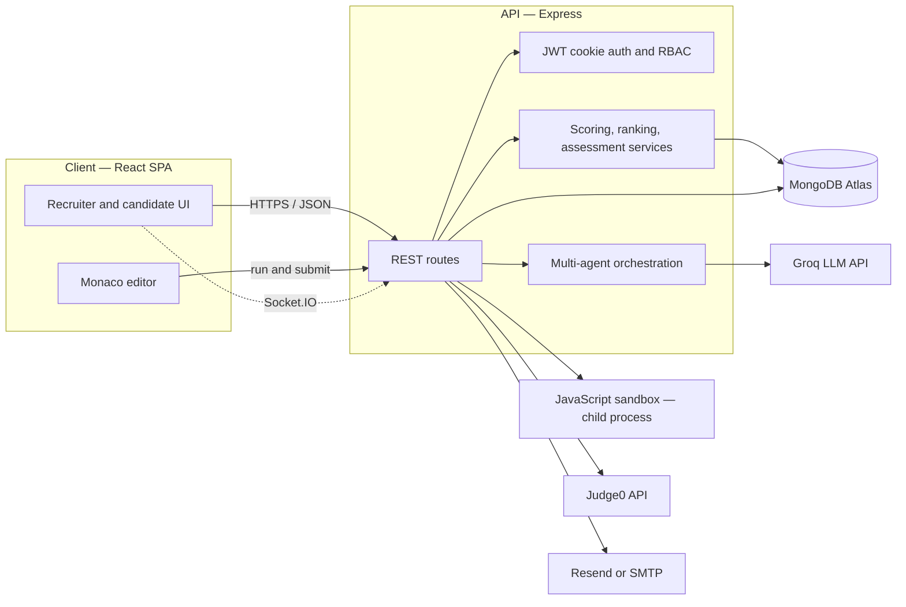

# NextHire AI

# Nexthire — AI-Powered Technical Hiring Platform

**Smarter technical hiring through AI-powered evaluation.**

Nexthire is a full-stack recruitment platform for technical roles. Recruiters publish jobs, screen resumes with an LLM, assign coding assessments, run interviews and rank applicants by a single weighted score. Candidates apply, complete a timed coding assessment, take an AI-assisted interview and follow their application status.

The problem it addresses is fragmented hiring evidence: a resume score, a coding score and an interview impression normally live in three tools and are compared by memory. Nexthire keeps all three per job, evaluates them consistently and derives one explainable ranking — while refusing to fabricate a result when an evaluator is unavailable.

**Intended users:** engineering recruiters and hiring teams, technical interviewers reviewing assessments, and candidates applying to technical roles.

---

<p>
  
  
  
  
  
  
</p>

---

## Table of Contents

- [Features](#features)
- [Application Screenshots](#application-screenshots)
- [Technology Stack](#technology-stack)
- [System Architecture](#system-architecture)
- [Project Structure](#project-structure)
- [Getting Started](#getting-started)
- [Environment Variables](#environment-variables)
- [Development Commands](#development-commands)
- [AI Evaluation and Candidate Ranking](#ai-evaluation-and-candidate-ranking)
- [Coding Assessment](#coding-assessment)
- [Authentication and Security](#authentication-and-security)
- [Testing](#testing)
- [Deployment](#deployment)
- [Current Limitations and Configuration Requirements](#current-limitations-and-configuration-requirements)
- [Roadmap](#roadmap)
- [Contributing](#contributing)
- [License](#license)
- [Acknowledgements](#acknowledgements)

---

## Features

### Recruiter Features

| Capability                | Description                                                                                                                                                     |
| ------------------------- | --------------------------------------------------------------------------------------------------------------------------------------------------------------- |
| Job management            | Create, edit, deactivate and delete job postings; each job has an owner (recruiter) and an applicant counter derived from real applications.                    |
| Applicant pipeline        | Browse applications per job, move candidates between `applied → screening → interview → shortlisted → hired` (or `rejected`), and keep private recruiter notes. |
| Resume screening          | Screen an uploaded resume or an already-attached application resume with the LLM; the result feeds the candidate's resume score for that job.                   |
| Candidate evaluation      | A unified candidate view combining application status, resume score, best coding submission, interview state and the weighted total.                            |
| Rankings                  | Per-job ranking with the official 30/40/30 weighting, deterministic tie-breaking and consistent totals across the candidate list and ranking screen.            |
| Coding assessments        | Generate an assessment for a job from the role and difficulty, review results per candidate, and regenerate questions without disturbing in-progress attempts.  |
| Interview management      | Create and drive a recruiter-initiated interview session, schedule a slot, review the AI summary and final report, and access the interview from `/interviews`. |
| Dashboard & notifications | Live pipeline counts, recent applications, resume/interview totals, in-app notifications and a Socket.IO agent monitor.                                         |
| AI assistant              | Ask natural-language questions about your own jobs, candidates and submissions; answers are grounded in the recruiter's data.                                   |

### Candidate Features

| Capability                        | Description                                                                                                                                              |
| --------------------------------- | -------------------------------------------------------------------------------------------------------------------------------------------------------- |
| Job discovery                     | Browse active public job postings with filters, and see which roles have already been applied for.                                                       |
| Applications                      | Apply to a job with an optional resume upload (PDF/DOC/DOCX/TXT); one application per job.                                                               |
| Application tracking              | See each application's status, attached resume, and withdraw an application while it is still in the `applied` stage.                                    |
| Coding assessments                | Open an assigned assessment, start a server-timed attempt, run code against sample tests, and submit once.                                               |
| AI interviews                     | Start an AI interview for an applied job, answer question by question, and receive a completed evaluation or an explicit "evaluation unavailable" state. |
| Assessment & interview visibility | Per-application assessment status (`not started`, `in progress`, `submitted`, `expired`) and interview status are shown alongside the application.       |

### AI and Evaluation

| Capability            | Description                                                                                                         |
| --------------------- | ------------------------------------------------------------------------------------------------------------------- |
| Resume evaluation     | Structured resume screening: 0–100 score, summary, strengths, weaknesses and a recommendation.                      |
| Assessment generation | Role- and difficulty-aware coding questions with test cases, generated per job.                                     |
| Code review           | Advisory qualitative feedback on submitted code (quality, complexity, suggestions); it never changes the pass rate. |
| Interview evaluation  | Per-answer scoring and a final summary with a 0–100 overall score.                                                  |
| Weighted scoring      | One composite score per candidate per job: **Resume 30% + Coding 40% + Interview 30%**.                             |

> Evaluation results are only ever one of three things: a genuine model result, a clearly labelled mock result in an explicitly enabled development mode, or an explicit "unavailable" state. A missing evaluator never produces a fabricated score.

---

## Application Screenshots

No screenshots are currently committed to this repository — the earlier design-iteration captures were development artefacts and have been removed. The UI is not represented by images here rather than by outdated ones.

To add current screenshots:

1. Create `docs/screenshots/`.
2. Capture the running app (do not use mockups) at a consistent width, e.g. 1440px.
3. Use descriptive filenames and reference them below:

```markdown


```

Suggested set: recruiter dashboard, job applicants, resume screening, coding assessment (candidate), AI interview, rankings.

---

## Technology Stack

| Layer                       | Technologies                                                                                                                                                            |
| --------------------------- | ----------------------------------------------------------------------------------------------------------------------------------------------------------------------- |
| **Frontend**                | React 18, Vite 5, React Router 6, Tailwind CSS 3, Zustand (state), Axios, Monaco Editor, Framer Motion, Socket.IO client, react-hot-toast, lucide-react, react-markdown |
| **Backend**                 | Node.js 22.8+ (ES modules), Express 4, Mongoose 8, Helmet, express-rate-limit, Multer, Winston (logging), pdf-parse (resume text extraction)                            |
| **Database**                | MongoDB (Atlas in production)                                                                                                                                           |
| **AI integration**          | Groq via `@langchain/groq` (default model `openai/gpt-oss-20b`), with a multi-agent orchestration layer and an MCP-style tool registry                                  |
| **Code execution**          | Isolated Node.js child-process sandbox for JavaScript; Judge0 for additional languages                                                                                  |
| **Real-time communication** | Socket.IO namespaces `/interview` (authenticated session chat) and `/notifications` (per-user and recruiter broadcast events)                                           |
| **Authentication**          | JWT access + refresh tokens in HttpOnly cookies, bcrypt password hashing, CSRF double-submit tokens                                                                     |
| **Email**                   | Resend HTTP API or SMTP                                                                                                                                                 |
| **File storage**            | Cloudinary (local disk fallback for development)                                                                                                                        |
| **Deployment**              | Render (API), Vercel (client), MongoDB Atlas (database)                                                                                                                 |

---

## System Architecture

The client is a single-page React application that talks to an Express REST API over HTTPS. The API owns all business logic: it authenticates requests with JWT cookies, enforces role-based authorization, persists data in MongoDB, and delegates evaluation to external services.



**Request flow**

1. The browser sends a request with its `nh_access` cookie (or a bearer token for API clients). `protect` verifies the JWT and loads the user; `authorize` enforces the role.
2. Controllers validate input and delegate business rules to services — scoring, ranking, assessment state, execution — so the same rule is applied everywhere.
3. Data is read from and written to MongoDB through Mongoose models.
4. AI evaluation goes through the agent layer to Groq; code execution goes to the local sandbox (JavaScript) or Judge0 (other configured languages).
5. Socket.IO pushes interview messages and notifications to authenticated participants only.

---

## Project Structure

```text
Nexthire/
├── client/                     React SPA (Vite)
│   ├── public/                 Static assets served as-is
│   ├── src/
│   │   ├── pages/              Auth, dashboard, jobs, candidates, resume, coding, interview, ranking, applications
│   │   ├── components/         Shared UI, sidebar, notification bell, assessment cells
│   │   ├── layouts/            Authenticated and auth-shell layouts
│   │   ├── services/           Axios client (cookie auth + CSRF) and Socket.IO client
│   │   └── store/              Zustand stores (auth, agent status)
│   ├── vercel.json             SPA rewrites and asset caching for Vercel
│   └── vite.config.js          Dev server and /api proxy
│
├── server/                     Express API (Node, ES modules)
│   ├── index.js                Bootstrap: CORS, rate limits, routes, Socket.IO, shutdown
│   ├── config/                 Database, logger, cookies, multer, port resolution
│   ├── routes/                 One router per resource, with authorization
│   ├── controllers/            Request handling and validation
│   ├── services/               Scoring, ranking, AI, email, sandbox, execution, assessment
│   ├── models/                 Mongoose schemas and indexes
│   ├── middlewares/            Auth, rate limiting, input sanitization, CSRF
│   ├── agents/                 Supervisor + resume, coding, interview, ranking, notification agents
│   ├── mcp/                    Tool registry (MongoDB, resume, Judge0, Cloudinary, notifications)
│   ├── sockets/                Interview and notification namespaces
│   ├── sandbox/                Isolated JavaScript runner (separate process)
│   ├── scripts/                Maintenance scripts
│   ├── tests/                  node:test suites
│   └── .env.example            Backend environment template
│
├── render.yaml                 Render blueprint for the API
├── package.json                Root convenience scripts (concurrently)
└── README.md
```

---

## Getting Started

### Prerequisites

- **Node.js 22.8 or newer** and npm — required by the JavaScript sandbox, which uses `vm.constants.DONT_CONTEXTIFY` and refuses to execute on older runtimes
- **MongoDB** — a local instance or a MongoDB Atlas cluster
- Optional: a Groq API key (AI evaluation), a Judge0 key (non-JavaScript execution), email and Cloudinary credentials

### Setup

```bash
# 1. Clone
git clone https://github.com/7wyk/NextHire-AI-Hiring-Platform.git
cd NextHire-AI-Hiring-Platform

# 2. Install all workspaces (root, client, server)
npm run install:all

# 3. Configure the backend
cp server/.env.example server/.env

# 4. Configure the client (optional locally — the Vite proxy handles /api)
cp client/.env.example client/.env

# 5. Run both apps
npm run dev
```

Then open **http://localhost:5173**. The API listens on **http://localhost:5000** and exposes a health check at `/api/health`.

If you prefer separate terminals:

```bash
npm run server     # API on :5000 (nodemon)
npm run client     # Vite dev server on :5173
```

### Optional: seed demo data

```bash
cd server && npm run seed
```

---

## Environment Variables

Real secrets belong in `server/.env` / `client/.env` locally, or in the provider's environment settings (Render, Vercel). They must never be committed — both files are git-ignored, and only the `.env.example` templates are tracked.

### Frontend Environment Variables

Defined in `client/.env.example`. Vite exposes only variables prefixed with `VITE_`.

| Variable       | Required                    | Purpose                                                                                                                                            |
| -------------- | --------------------------- | -------------------------------------------------------------------------------------------------------------------------------------------------- |
| `VITE_API_URL` | Production: yes · Local: no | Absolute API base URL including `/api`, e.g. `https://<api>.onrender.com/api`. Leave empty locally so the Vite proxy forwards `/api` to port 5000. |

### Backend Environment Variables

Defined in `server/.env.example`.

**Core**

| Variable      | Required   | Purpose                                                                                                      |
| ------------- | ---------- | ------------------------------------------------------------------------------------------------------------ |
| `NODE_ENV`    | Yes        | `development` locally, `production` on Render. Controls secure cookies, JSON logs and error-detail exposure. |
| `PORT`        | Local only | API port, default `5000`. Render injects its own value; do not set it there.                                 |
| `MONGODB_URI` | Yes        | MongoDB connection string, e.g. `mongodb+srv://…/nexthire`.                                                  |

**Authentication**

| Variable               | Required | Purpose                                              |
| ---------------------- | -------- | ---------------------------------------------------- |
| `JWT_SECRET`           | Yes      | Signs access tokens. Use a long random string.       |
| `JWT_REFRESH_SECRET`   | Yes      | Signs refresh tokens; must differ from `JWT_SECRET`. |
| `JWT_ACCESS_EXPIRES`   | Optional | Access token lifetime (default `15m`).               |
| `JWT_REFRESH_EXPIRES`  | Optional | Refresh token lifetime (default `7d`).               |
| `ACCESS_TOKEN_MINUTES` | Optional | Access cookie lifetime in minutes (default `15`).    |
| `REFRESH_TOKEN_DAYS`   | Optional | Refresh cookie lifetime in days (default `7`).       |

**Origins**

| Variable           | Required          | Purpose                                                                         |
| ------------------ | ----------------- | ------------------------------------------------------------------------------- |
| `CLIENT_URL`       | Yes in production | Exact browser origin of the client. Used for CORS, cookies and links in emails. |
| `CORS_ORIGINS`     | Optional          | Extra allowed origins, comma-separated (e.g. a Vercel preview domain).          |
| `TRUST_PROXY_HOPS` | Optional          | Reverse-proxy hops in front of the app; `1` on Render (default).                |

**AI**

| Variable       | Required        | Purpose                                                                                                                                                 |
| -------------- | --------------- | ------------------------------------------------------------------------------------------------------------------------------------------------------- |
| `GROQ_API_KEY` | For AI features | Enables resume screening, assessment generation, code review and interviews. Without it those endpoints return an explicit `503 evaluationUnavailable`. |
| `GROQ_MODEL`   | Optional        | Model name (default `openai/gpt-oss-20b`).                                                                                                              |
| `AI_MOCK_MODE` | Optional        | `true` returns clearly labelled `mock: true` results for local development. Ignored when `NODE_ENV=production`.                                         |

**Code execution**

| Variable         | Required                     | Purpose                                                       |
| ---------------- | ---------------------------- | ------------------------------------------------------------- |
| `JUDGE0_API_KEY` | For non-JavaScript languages | Enables Python, Java, C++, and others via Judge0.             |
| `JUDGE0_URL`     | Optional                     | Judge0 endpoint (default `https://judge0-ce.p.rapidapi.com`). |
| `JUDGE0_HOST`    | Optional                     | RapidAPI host header for Judge0.                              |

**Email**

| Variable                                                          | Required             | Purpose                                                                                              |
| ----------------------------------------------------------------- | -------------------- | ---------------------------------------------------------------------------------------------------- |
| `RESEND_API_KEY`                                                  | For email via Resend | Takes precedence over SMTP when set.                                                                 |
| `SMTP_HOST`, `SMTP_PORT`, `SMTP_SECURE`, `SMTP_USER`, `SMTP_PASS` | For email via SMTP   | Used when Resend is not configured. SMTP requires the optional `nodemailer` package to be installed. |
| `EMAIL_FROM`                                                      | Optional             | Sender address (default `Nexthire <no-reply@nexthire.app>`).                                         |
| `EMAIL_REPLY_TO`                                                  | Optional             | Reply-to address.                                                                                    |

**Storage and search**

| Variable                                                               | Required                | Purpose                                                                                                |
| ---------------------------------------------------------------------- | ----------------------- | ------------------------------------------------------------------------------------------------------ |
| `CLOUDINARY_CLOUD_NAME`, `CLOUDINARY_API_KEY`, `CLOUDINARY_API_SECRET` | Production: recommended | Persistent resume storage. Without them uploads fall back to local disk, which is ephemeral on Render. |
| `USE_VECTORLESS`                                                       | Optional                | Enables the vectorless candidate search path (default `true`).                                         |
| `PINECONE_API_KEY`, `PINECONE_INDEX`                                   | Optional                | Only needed for the optional Pinecone-backed vector service.                                           |

**Logging and rate limits**

| Variable                                                                                                                                                                                                                          | Required | Purpose                                                                                             |
| --------------------------------------------------------------------------------------------------------------------------------------------------------------------------------------------------------------------------------- | -------- | --------------------------------------------------------------------------------------------------- |
| `LOG_LEVEL`                                                                                                                                                                                                                       | Optional | Winston level (default `info`).                                                                     |
| `LOG_TO_FILE`                                                                                                                                                                                                                     | Optional | Writes rotating files; production logs to stdout by default.                                        |
| `RATE_LIMIT_GLOBAL_MAX`, `RATE_LIMIT_AUTH_MAX`, `RATE_LIMIT_PASSWORD_RESET_MAX`, `RATE_LIMIT_AI_MAX`, `RATE_LIMIT_RESUME_MAX`, `RATE_LIMIT_CODE_MAX`, `RATE_LIMIT_INTERVIEW_MAX`, `RATE_LIMIT_AGENT_MAX`, `RATE_LIMIT_UPLOAD_MAX` | Optional | Per-route request budgets. Defaults are documented in `server/middlewares/rateLimit.middleware.js`. |

---

## Development Commands

All commands are the scripts declared in the repository — no additional tooling is required.

| Task                              | Command                                                             | Working directory                    |
| --------------------------------- | ------------------------------------------------------------------- | ------------------------------------ |
| Install everything                | `npm run install:all`                                               | root                                 |
| Run API + client together         | `npm run dev`                                                       | root                                 |
| Run the API only                  | `npm run server`                                                    | root (or `npm run dev` in `server/`) |
| Run the client only               | `npm run client`                                                    | root (or `npm run dev` in `client/`) |
| Backend tests                     | `npm test`                                                          | `server/`                            |
| Seed demo data                    | `npm run seed`                                                      | `server/`                            |
| Production API start              | `npm start`                                                         | `server/`                            |
| Production client build           | `npm run build`                                                     | `client/`                            |
| Preview the built client          | `npm run preview`                                                   | `client/`                            |
| Recompute stored candidate totals | `npm run migrate:totals`                                            | `server/`                            |
| Reconcile job applicant counters  | `node scripts/reconcileApplicantCounts.js` (add `--apply` to write) | `server/`                            |

---

## AI Evaluation and Candidate Ranking

### The scoring formula

The composite score is computed in exactly one place — `server/services/candidateProfile.service.js` — and the weights are fixed:

```
totalScore = round(resumeScore × 0.30 + codeScore × 0.40 + interviewScore × 0.30)
```

| Component | Weight | Source                                                                   |
| --------- | ------ | ------------------------------------------------------------------------ |
| Resume    | 30%    | AI resume screening for that job                                         |
| Coding    | 40%    | The candidate's submission for that job's assessment                     |
| Interview | 30%    | The AI interview evaluation (or the recruiter-initiated session summary) |

### Normalisation and missing data

- Every component is clamped to **0–100**; the total uses `Math.round` on the weighted sum.
- An assessment that was never completed contributes **0**.
- An assessment that finished but could not be evaluated is reported as **unavailable** — it contributes 0 to the total and is never displayed as a genuine 0.
- Scores are stored per `(job, candidate email)`, so one candidate applying to two jobs has two independent scores, and scores never leak between jobs.

### Ranking and ties

Ranking sorts by total score descending, then:

1. higher **resume** score,
2. then candidate `_id` ascending, so ties are deterministic.

Rank numbers are assigned only after the final sort, which keeps the candidate list, the ranking screen and the dashboard consistent. The ranking service is the single source of totals for every view.

> **Availability:** AI evaluation requires `GROQ_API_KEY`. Without it, screening, assessment generation and interviews return `503 evaluationUnavailable` rather than inventing results. Candidates keep their existing scores; no zero is written for a failed evaluation.

---

## Coding Assessment

### How an assessment is created

1. A recruiter generates an assessment for a job: `POST /api/coding-test/generate` with role, difficulty (`easy` / `medium` / `hard`) and question count (default 3).
2. Questions and their test cases are produced by the AI layer; a generation failure returns `503` and creates nothing.
3. Each generation is **versioned**: the outgoing question set is archived and `revision` increments, so a candidate who already started keeps the questions they began with.

### Attempts and timing

- `GET /api/coding-test/:jobId` is read-only and reports the attempt state.
- `POST /api/coding-test/:jobId/start` creates the server-side clock exactly once; repeated calls return the original start time, so reloading cannot reset it.
- The time budget is the sum of the per-question limits (default 15 minutes each).
- One submission per candidate per job is enforced by a unique index; duplicates return `409`.
- An abandoned, expired attempt can be restarted within the configured cap (default 2 starts).

### Supported languages

| Language                                                                    | Runtime                                   |
| --------------------------------------------------------------------------- | ----------------------------------------- |
| JavaScript                                                                  | Local isolated sandbox — always available |
| Python, Java, C++, C, TypeScript, Go, Rust, Ruby, C#, PHP, Swift, Kotlin, R | Judge0 — **requires `JUDGE0_API_KEY`**    |

The assessment editor currently offers JavaScript, Python, Java and C++. Languages the server cannot execute are disabled rather than silently scored zero.

### Execution and grading

- **Sandbox (JavaScript):** code runs in a separate Node process with an empty environment and a temporary working directory. Inside it, a genuine new V8 realm is created with string code generation disabled and strict mode enforced; the process has a hard wall-clock limit. This prevents access to `process`, environment variables and server secrets.
- **Judge0:** used for other configured languages; infrastructure failures return `503 executionUnavailable` and nothing is saved, while a candidate's own compile/runtime error counts as a failed test case.
- **Scoring:** each question's test cases are graded by exact trimmed output match. Answers are matched to questions by `questionIndex`, and skipped questions keep their cases in the denominator, so an incomplete attempt cannot score 100%.
- **Advisory review:** an AI code review (quality, complexity, suggestions) is attached when available; it never affects the pass rate.

---

## Authentication and Security

### Authentication

- Passwords are hashed with **bcrypt (cost 12)**; passwords are never stored or logged in plain text.
- Login issues a **15-minute access token** and a **7-day refresh token** as **HttpOnly cookies** (`nh_access`, `nh_refresh`). The browser client stores no token in JavaScript or `localStorage`.
- Refresh tokens are stored **hashed** server-side and **rotated** on every refresh; logout revokes the stored hash and clears the cookies. An `Authorization: Bearer` token is still accepted for API clients.
- Failed logins are counted; five failures lock the account for 15 minutes.
- Password reset tokens are random, **single-use**, stored hashed, expire after one hour, and are only ever delivered inside the reset email — never in a log line or API response.

### Authorization

- Three roles: `candidate`, `recruiter`, `admin`. Authorization is enforced server-side with `authorize(...)` on every router; frontend route guards are convenience only.
- Recruiter-owned resources are scoped to the owner: jobs, applicants, candidate profiles, interview sessions and assessment results.
- Candidate resources are scoped to the authenticated user: applications, submissions, attempts and interviews.
- Resume files and interview jobs are ownership-checked, not merely authenticated.

### Request hardening

| Control         | Implementation                                                                                                                                                                                      |
| --------------- | --------------------------------------------------------------------------------------------------------------------------------------------------------------------------------------------------- |
| CSRF            | Double-submit token: the readable `nh_csrf` cookie must be echoed in `X-CSRF-Token` on cookie-authenticated mutations. Bearer-token requests are exempt (a cross-site page cannot set that header). |
| Cookies         | `HttpOnly`; `SameSite=None; Secure` in production (client and API are different origins), `SameSite=Lax` in development.                                                                            |
| NoSQL injection | `$`-prefixed operators and dotted keys are stripped from body, query and params.                                                                                                                    |
| Path parameters | ObjectId validation before any database lookup.                                                                                                                                                     |
| Rate limiting   | Separate budgets per route class, keyed by user id when authenticated (see below).                                                                                                                  |
| CORS            | Explicit origin allow-list with credentials; unknown origins are rejected.                                                                                                                          |
| Headers         | Helmet.                                                                                                                                                                                             |
| Errors          | 5xx responses return a generic message in production; details stay in the logs.                                                                                                                     |

**Rate limit defaults** (per 15 minutes unless noted): global 2000 · auth 20 · password reset 5 per hour · AI 60 · resume 40 · code execution 240 · interview 150 · agent polling 1200 · uploads 30.

### Assessment execution isolation

Candidate code never runs inside the API process. JavaScript executes in a spawned child process with an empty environment and a temporary working directory; the V8 context has no host objects, string code generation disabled and strict mode enforced, with a VM timeout plus a hard process kill. This isolation is covered by tests that attempt environment access, constructor escape and a runaway loop.

---

## Testing

The backend uses Node's built-in test runner — no external test framework, database, or credentials are required.

```bash
cd server
npm test        # node --test "tests/*.test.js"
```

The last verified run recorded **110 passing tests, 0 failures**. Test files:

| Suite                      | Covers                                                                                       |
| -------------------------- | -------------------------------------------------------------------------------------------- |
| `scoring.test.js`          | Weights, rounding, clamping, missing components                                              |
| `ranking.test.js`          | Ordering, ties, per-job scoping, computed totals                                             |
| `identity.test.js`         | Candidate identity resolution across jobs                                                    |
| `aiIntegrity.test.js`      | Result envelopes, mock labelling, no fabricated scores                                       |
| `interviewScoring.test.js` | Answer inclusion/exclusion, unavailable evaluations                                          |
| `codingAssessment.test.js` | Question mapping, pass-rate denominator, runtimes, sandbox escape and timeout                |
| `assessment.test.js`       | Attempt state, revision pinning, restart cap                                                 |
| `authSecurity.test.js`     | Cookies, CSRF, injection guards, rate-limit policy, email failure modes, route authorization |
| `security.test.js`         | Reset-token handling, port resolution                                                        |
| `interviewSocket.test.js`  | Socket authentication and participant authorization                                          |

Suites that exercise "unavailable" paths deliberately remove provider keys; no test makes a live AI or Judge0 call. A passing suite in one environment does not guarantee external integrations are configured there.

Frontend verification is a production build check:

```bash
cd client && npm run build
```

---

## Deployment

Nexthire deploys as three managed services: **Render** (API), **Vercel** (client) and **MongoDB Atlas** (database). The repository includes configuration for the first two; no deployment is implied or included here.

### Backend on Render

| Setting           | Value                                                             |
| ----------------- | ----------------------------------------------------------------- |
| Root directory    | `server`                                                          |
| Build command     | `npm ci --omit=dev`                                               |
| Start command     | `node index.js`                                                   |
| Health check path | `/api/health?check=full`                                          |
| Runtime           | Node 22.8 or newer (required for JavaScript assessment execution) |

`render.yaml` declares these values (root directory, commands, health check); confirm the service's Node version is 22.8+ so the sandbox can start. Set the environment variables from [Environment Variables](#environment-variables) in the Render dashboard; mark secrets as secret and never commit them. The server binds `0.0.0.0:$PORT`, trusts one proxy hop, and shuts down gracefully on `SIGTERM`.

### Frontend on Vercel

| Setting              | Value                                 |
| -------------------- | ------------------------------------- |
| Root directory       | `client`                              |
| Framework preset     | Vite                                  |
| Build command        | `npm run build`                       |
| Output directory     | `dist`                                |
| Environment variable | `VITE_API_URL=https://<api-host>/api` |

`client/vercel.json` provides SPA rewrites so deep links survive a refresh, plus immutable caching for hashed assets. Because the client and API are different origins in production, the API's `CLIENT_URL` must match the deployed client origin exactly (including `https://`, no trailing slash), and any preview domain must be added to `CORS_ORIGINS`.

### Database on MongoDB Atlas

1. Create a cluster and a database user scoped to the `nexthire` database.
2. Allow network access only from your API host's egress addresses; avoid leaving `0.0.0.0/0` as a permanent setting.
3. Put the `mongodb+srv://` connection string in `MONGODB_URI` on Render.
4. Indexes are created by Mongoose on first boot. No manual migration step is required.
5. Enable Atlas backups appropriate to your plan.

### External integrations

| Integration    | Needed for                                                       | Configuration                      |
| -------------- | ---------------------------------------------------------------- | ---------------------------------- |
| Groq           | Resume screening, assessment generation, code review, interviews | `GROQ_API_KEY`                     |
| Judge0         | Non-JavaScript code execution                                    | `JUDGE0_API_KEY` (+ endpoint/host) |
| Resend or SMTP | Password reset, application, status and interview emails         | `RESEND_API_KEY` or `SMTP_*`       |
| Cloudinary     | Persistent resume storage in production                          | `CLOUDINARY_*`                     |

### Post-deploy checks

1. `GET /api/health?check=full` returns `status: "ok"` with `database: "connected"`.
2. Register a candidate and a recruiter; confirm the session cookies are HttpOnly and survive a reload.
3. Screen a resume, start an assessment, run code and submit.
4. Complete an AI interview and confirm the ranking total matches the candidate list.

---

## Current Limitations and Configuration Requirements

These are implementation facts, not defects hidden behind configuration:

| Area                                                   | Status                                                                                                                                                                        |
| ------------------------------------------------------ | ----------------------------------------------------------------------------------------------------------------------------------------------------------------------------- |
| Resume screening, assessment generation, interviews    | **Implemented.** Require `GROQ_API_KEY`; without it they return an explicit unavailable response and store no score.                                                          |
| JavaScript code execution                              | **Implemented and self-contained.** Runs locally in an isolated sandbox; no external key needed.                                                                              |
| Python, Java, C++, and other languages                 | **Implemented, requires Judge0.** Without `JUDGE0_API_KEY` those languages are disabled in the editor and rejected with `503`.                                                |
| Email delivery (reset, application, status, interview) | **Implemented, requires a provider.** With no Resend/SMTP configuration, sending is skipped and logged — never reported as delivered.                                         |
| Persistent resume storage                              | **Implemented.** Cloudinary is required in production because the Render filesystem is ephemeral; otherwise uploads fall back to local disk.                                  |
| Browser end-to-end verification                        | **Outstanding.** Automated tests cover backend logic and the sandbox, but a full recruiter/candidate click-through in a deployed browser is still a manual verification step. |
| Standalone practice problems                           | `/api/code/*` exists for individual problem runs and submissions; it is authenticated but not restricted to candidates.                                                       |
| Runtime version                                        | **Node.js 22.8+ is required** for JavaScript assessment execution. On older runtimes the sandbox fails closed and JavaScript submissions cannot be graded.                    |

---

## Roadmap

Planned work — none of this is implemented yet:

- Broader assessment language coverage and per-language starter templates.
- Richer recruiter analytics and exportable hiring reports.
- Calendar and ATS integrations for interview scheduling.
- Expanded automated coverage, including browser-level end-to-end tests.
- Additional email templates and notification preferences.

---

## Contributing

1. Fork the repository.
2. Create a focused feature branch: `git checkout -b feature/short-description`.
3. Keep changes scoped — do not mix refactors with fixes.
4. Run the checks before opening a pull request:

   ```bash
   cd server && npm test
   cd ../client && npm run build
   ```

5. Add or update tests when behaviour changes, and describe the verification you performed.
6. Open a pull request explaining the problem, the approach, and any configuration it needs (for example a new environment variable).

Do not commit `.env` files, credentials or generated build output.

---

## License

This repository does not currently include a `LICENSE` file, so no open-source license is declared. All rights are reserved by the copyright holder until a license is added. If you intend to accept external contributions or allow reuse, add a license file (for example MIT or Apache-2.0) and reference it here.

---

## Acknowledgements

Built with the open-source ecosystem around React, Vite, Tailwind CSS, Express, Mongoose, Socket.IO, Monaco Editor and LangChain, and with AI inference from Groq. Coding execution for non-JavaScript languages is provided by Judge0.

No author or maintainer metadata is declared in this repository; the canonical source is the GitHub repository itself.
